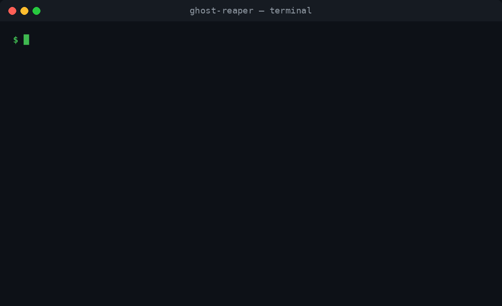
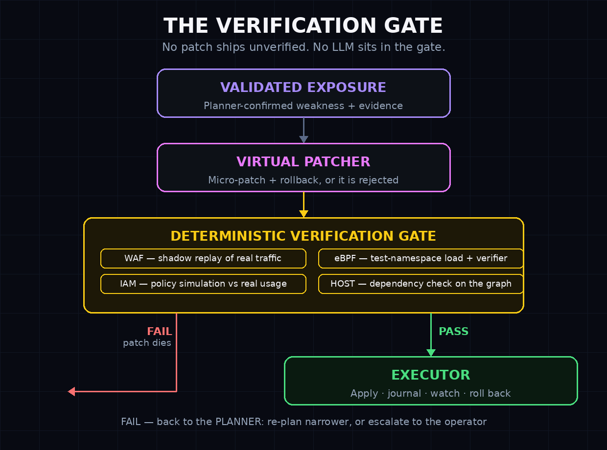
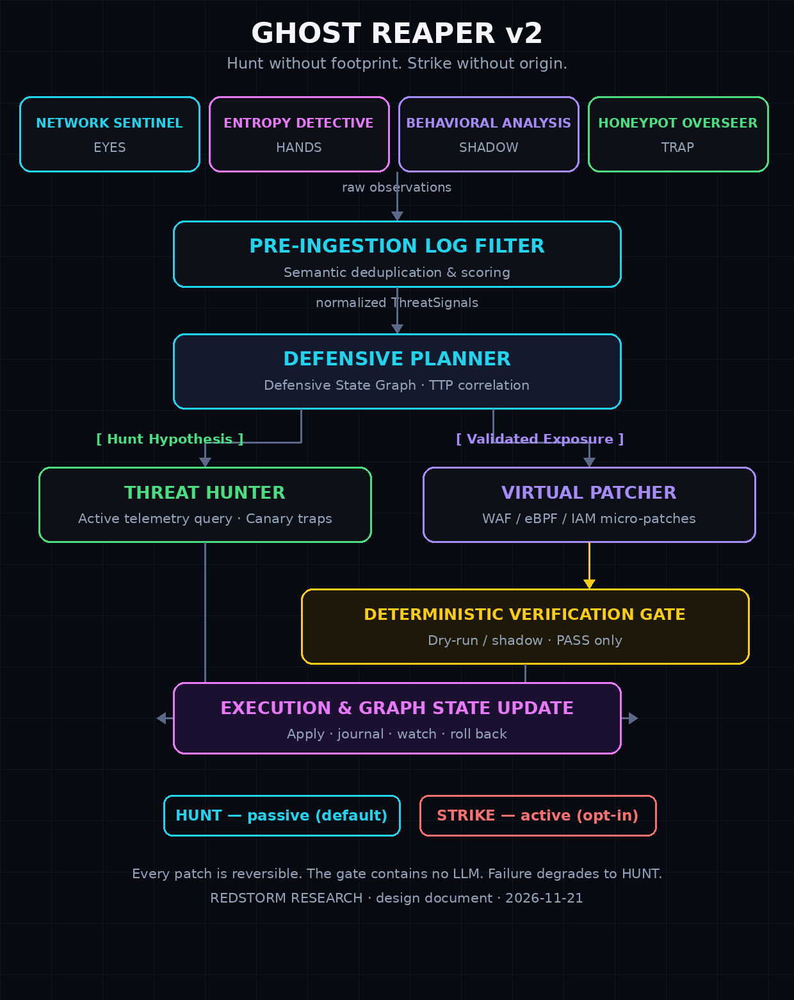

# Ghost Reaper 👻

> *Hunt without footprint. Strike without origin.*

**Ghost Reaper v2** — the defensive answer to **ARTEX-class agent attacks**. Four AI agents watch your machine — network connections, file entropy, process behavior, honeypot tripwires — a Defensive Planner fuses their signals against a persistent state graph, and in STRIKE mode a Virtual Patcher closes exposures behind a deterministic Verification Gate. No patch executes unverified. Every patch can roll back.

```
git clone https://github.com/Insider77Circle/Ghost-Reaper.git && cd Ghost-Reaper
pip install -r requirements.txt
cp .env.example .env   # set LLM_PROVIDER + LLM_API_KEY
python main.py --scan-once --json   # one snapshot, pipe it anywhere
```

**Full-Spectrum AI Threat Detection · Agent Cluster + Verified Response Loop**


> *"Hunt without footprint. Strike without origin."*

Ghost Reaper is an AI-powered threat detection and response system built on a multi-agent cluster architecture. Each agent monitors a distinct attack surface. All signals are deduplicated, scored, and fused by the Defensive Planner — an LLM-powered analysis layer with persistent memory — which delivers structured, actionable threat verdicts with zero noise. In STRIKE mode it goes further: hunting hypotheses, generating micro-patches, and executing only what a deterministic gate has verified in dry-run first.

<p align="center">
  
</p>

*One pass: the cluster catches a beacon + a touched canary, the Planner validates the exposure, the Gate shadow-verifies the patch — then, and only then, it executes.*

---

## Why Ghost Reaper?

Attackers automated first. ARTEX-style frameworks decompose intrusions into agent tasks and execute them at machine speed — the FBI's November 2026 FLASH alert on ARTEX-linked campaigns (Storm-0940's ConnectWise exploitation, 2,250+ Microsoft 365 tenants hit) is what that looks like in the wild. Defense that ends at an alert loses that race. Ghost Reaper takes a different approach:

- **Built for the ARTEX era** — designed against agent-speed offense: machine-speed TTP correlation, hypothesis-driven hunting, and verified automated response
- **Signal fusion over alert spam** — four detection agents feed one planning layer, which reasons across all signals simultaneously before issuing a verdict
- **Memory, not just monitoring** — the Defensive State Graph remembers every signal, exposure, and patch across cycles, so campaigns are recognized as campaigns
- **LLM-powered analysis** — the Planner doesn't just flag threats, it explains them, identifies IOCs, and turns them into remediation
- **Verified action, never blind action** — every micro-patch passes a deterministic Verification Gate (dry-run / shadow) before execution. No LLM output bypasses it. Every patch carries its own rollback
- **Passive by default** — HUNT mode monitors without interfering and leaves no network footprint. STRIKE mode (active hunting + patching) is opt-in per environment
- **Bring your own LLM** — works with any provider: OpenAI, DeepSeek, Groq, Anthropic, Mistral, Ollama, or any OpenAI-compatible endpoint
- **Pluggable intelligence feeds** — add AbuseIPDB, VirusTotal, Shodan, or your own custom feed with one Python file

---

## The Agent Cluster

Ghost Reaper runs four specialized sensing agents in parallel, plus the synthesis layer that v2 evolves into the Defensive Planner. Each owns a detection domain.

### 👁️ Network Sentinel — *EYES*

Watches all active network connections using live system data.

**Detects:**

- **C2 beaconing** — analyzes connection intervals to identify regular-heartbeat patterns characteristic of command-and-control malware
- **Suspicious port activity** — flags connections to known C2/shell ports (4444, 31337, 9001, IRC ports, etc.)
- **High connection counts** — catches processes with abnormal simultaneous connection counts, indicating scanners or botnet activity
- **Process-to-connection mapping** — ties every suspicious connection back to the owning process

---

### 🔬 Entropy Detective — *HANDS*

Calculates Shannon entropy on files landing in watched directories.

**Detects:**

- **Packed executables** — malware commonly uses packers (UPX, custom) that produce near-random byte distributions
- **Encrypted payloads** — ransomware staging files, encrypted shellcode loaders, and exfiltration archives all score high entropy
- **Obfuscated scripts** — heavily encoded PowerShell, VBScript, and JavaScript frequently exceeds natural language entropy levels
- **Configurable thresholds and watch paths** — tune sensitivity and add directories via `.env`

Entropy is scored out of 8.0. Ghost Reaper flags at 7.2+ (suspicious) and 7.6+ (HIGH severity).

---

### 🧠 Behavioral Analysis — *SHADOW*

Tracks process creation chains and identifies known abuse patterns.

**Detects:**

- **Suspicious parent-child chains** — Office apps, browsers, and PDF readers that spawn `cmd.exe`, `powershell.exe`, `wscript.exe`, or other shell processes. Classic macro and drive-by exploit signatures
- **LOLBin (Living-off-the-Land Binary) abuse** — monitors execution of `certutil.exe`, `bitsadmin.exe`, `mshta.exe`, `regsvr32.exe`, `msbuild.exe`, and other commonly abused Windows binaries
- **Process masquerading** — catches malware running as `svchost.exe`, `lsass.exe`, or other system processes from unexpected filesystem paths (a common rootkit technique)
- **Lateral movement indicators** — correlates process activity across the system to identify unusual propagation patterns

---

### 🪤 Honeypot Overseer — *TRAP*

Deploys canary tokens and decoy listeners. Any access is a confirmed threat.

**Deploys:**

- **Canary credential files** — fake `credentials.txt`, `aws_keys.json`, `db_config.yml`, `id_rsa`, and backup codes placed in a configurable directory. Legitimate processes never touch these
- **Decoy network listeners** — opens configurable ports (default: 21, 23, 3389) that serve fake banners. Any connection is an active intruder, not a false positive
- **Mtime/atime monitoring** — detects file access, modification, or deletion of canary assets

Any honeypot trigger fires a **CRITICAL** severity signal immediately — bypassing the normal synthesis interval for instant escalation.

---

### ⚡ Synthesis Oracle — *BRAIN* → Defensive Planner

The intelligence layer that makes Ghost Reaper more than a collection of scanners. In v2 the Oracle becomes the **Defensive Planner** (see The v2 Loop below): same fusion, plus persistent memory and intent.

**Process:**

1. Receives signals from all four agents — deduplicated and scored by the Pre-Ingestion Log Filter
2. Enriches indicators (IPs, hashes) against configured threat feeds
3. Correlates signals against the Defensive State Graph and known TTPs
4. Returns a complete threat verdict — or, in STRIKE mode, a Hunt Hypothesis or Validated Exposure

**Verdict includes:**

- **Severity** — CLEAN / LOW / MEDIUM / HIGH / CRITICAL
- **Threat type** — e.g. Ransomware Staging, C2 Beaconing, Credential Harvesting, Lateral Movement
- **Confidence level** — LOW / MEDIUM / HIGH
- **Contributing sources** — which agents triggered
- **Technical analysis** — multi-paragraph explanation of what happened and what it means
- **IOCs** — indicators of compromise extracted from the signals
- **Recommended actions** — concrete remediation steps, not generic advice — in STRIKE mode, expressed as patch objects

---

## The v2 Loop

v2 completes the loop the sensors started:

```
SENSE → FILTER → PLAN → HUNT / PATCH → VERIFY → EXECUTE → REMEMBER
```

### 🧹 Pre-Ingestion Log Filter

Semantic deduplication and scoring between the agents (and log feeds) and the Planner. The same event described three ways collapses into one canonical ThreatSignal, scored 0–1 on source reliability, baseline rarity, and cross-source corroboration. Deterministic scoring — the LLM consumes scores, it doesn't invent them.

### 🗺️ Defensive Planner

The Synthesis Oracle, evolved. Maintains the **Defensive State Graph** — hosts, identities, processes, files, exposures, and applied patches as nodes; observed relationships as edges — and correlates incoming signals to attacker TTPs across time. Every cycle it emits up to two outputs:

- **Hunt Hypothesis** — a plausible but unproven suspicion, routed to the Threat Hunter with the exact telemetry that would confirm or kill it. A hypothesis must name its falsifier.
- **Validated Exposure** — a confirmed weakness with evidence attached: the v1 verdict, hardened, with the remediation target made explicit.

### 🔦 Threat Hunter

The Honeypot Overseer with a mandate to go looking. Keeps the canary files and decoy listeners, adds deliberate trap placement along predicted attacker paths and **active telemetry query** — hypothesis-driven, read-only lookups across host telemetry and log stores. Hypotheses return CONFIRMED, REFUTED (refutations are memory too), or UNRESOLVED.

### 🩹 Virtual Patcher

Turns Validated Exposures into **micro-patches** — the smallest change that closes the specific exposure, on the surface where it lives:

- **WAF rules** — block the observed pattern at the edge, scoped to the affected application
- **eBPF filters** — kernel-level drops for the observed behavior: the beacon's destination, the masquerading process's syscall pattern
- **IAM micro-patches** — least-privilege diffs: remove the one permission the exposure abuses
- **Host actions** — quarantine the file, kill the process tree, disable the account — as patch objects, not prose

A patch that cannot describe its own rollback is rejected at construction and never reaches the Gate.

### ✅ Deterministic Verification Gate

The load-bearing wall of v2. Every micro-patch passes here before execution — there is no other path.

- **WAF** — replay sampled real traffic against the proposed rule in shadow; measure false positives before the rule can bite
- **eBPF** — load in a test namespace; kernel verifier plus behavior diff against baseline
- **IAM** — policy simulation against recent access patterns: who loses access they actually used?
- **Host actions** — dependency check against the State Graph: what breaks if this dies?

Verdicts are PASS or FAIL with the measured evidence attached. **No LLM sits in the gate.** On FAIL, the patch dies and the exposure returns to the Planner to re-plan or escalate.

<p align="center">
  
</p>

### ♻️ Execution & Graph State Update

PASSed patches are applied with scoped, per-target credentials; every apply is journaled (intent, patch id, gate verdict id, result). Outcomes write back to the State Graph immediately — and post-patch telemetry is watched: if the exposure's signature persists, the exposure reopens. Any applied patch can be rolled back from its journal entry at any time.

### Modes

| Mode | Behavior |
| --- | --- |
| **HUNT** (default) | Sense, filter, plan, report. No active queries, no patches, no execution credentials loaded. Exactly v1's posture. |
| **STRIKE** (opt-in) | Full loop. Hunter queries actively, Patcher generates, Gate verifies, Executor applies — only in environments the operator enabled, and only after a startup self-check passes. |

Every v2 component fails toward HUNT: if the Filter, Graph, Gate, or Executor errors, the system degrades to detect-and-report rather than acting on partial information.

---

## Use Cases

| Scenario | How Ghost Reaper Helps |
| --- | --- |
| **ARTEX-class agent attack defense** | Planner-speed correlation and verified response built for intrusions that unfold at machine speed |
| **SOC monitoring** | Run continuously alongside your SIEM. Ghost Reaper surfaces behavioral and entropy signals that signature-based tools miss |
| **Autonomous remediation (STRIKE)** | Verified micro-patches close exposures in seconds — behind a deterministic gate, with rollback |
| **Incident response** | `--scan-once --json` gives a rapid structured snapshot of current system state for IR triage |
| **Malware analysis lab** | Drop samples into watched directories, execute them in a VM — Entropy Detective and Behavioral Analysis capture the execution profile |
| **Red team detection gap assessment** | Run Ghost Reaper against your own infrastructure during an authorized engagement to see what it catches — and what slips past |
| **Developer security testing** | Monitor your dev environment for dependency confusion attacks, supply chain compromises, or rogue build scripts |
| **Honeypot research** | Customize canary files and decoy ports to study attacker behavior and tool signatures |

---

## LLM Provider Support

Ghost Reaper works with any LLM that exposes an OpenAI-compatible API, plus native Anthropic support.

| Provider | `LLM_PROVIDER` value | Notes |
| --- | --- | --- |
| OpenAI | `openai` | GPT-6.2 Astra, GPT-6.2 Sol, GPT-6.1 Terra, GPT-6 Luna |
| DeepSeek | `deepseek` | DeepSeek V4 Pro, V4.1-Flash — open weights (MIT) |
| Groq | `groq` | Fast inference — Llama 4, Qwen3.8, gpt-oss-120b, Kimi K3 |
| Together AI | `together` | Wide open-weight selection — Kimi K3.1 Pro, GLM-5.3, DeepSeek V4, Qwen3.8 |
| Mistral | `mistral` | Mistral Large 4 and the current Mistral family |
| Anthropic | `anthropic` | Claude Fable 5.2, Opus 5.5, Sonnet 5.5, Haiku 5.5 |
| Ollama | `ollama` | Local open-weight models — Qwen3.8-27B, Gemma 4 31B, gpt-oss-120b, Llama 4 Scout — fully offline |
| Custom | `custom` | Set `LLM_BASE_URL` to any OpenAI-compatible endpoint — incl. Gemini 4 Carbon / Argon and Grok 4.7 |

---

## Threat Intelligence Feeds

All feeds are optional. Ghost Reaper works without any feeds — they add enrichment context to the Planner's analysis.

| Feed | What it adds | Key required |
| --- | --- | --- |
| **AbuseIPDB** | Abuse confidence score, report count, ISP, Tor flag | `ABUSEIPDB_API_KEY` |
| **VirusTotal** | Multi-AV scan results for IPs, domains, file hashes | `VIRUSTOTAL_API_KEY` |
| **Shodan** | Open ports, org, known CVEs, hostnames for IPs | `SHODAN_API_KEY` |
| **Custom** | Drop a Python file in `feeds/` with `FEED_NAME` and `query(indicator)` | Your own |

---

## Installation

```
# Clone
git clone https://github.com/Insider77Circle/Ghost-Reaper.git
cd Ghost-Reaper

# Install dependencies
pip install -r requirements.txt

# Configure
cp .env.example .env
# Edit .env — set LLM_PROVIDER, LLM_API_KEY, LLM_MODEL
# Optionally add feed API keys
```

---

## Configuration

All configuration lives in `.env`. Copy `.env.example` to get started.

```
# Required
LLM_PROVIDER=openai          # or deepseek, groq, anthropic, mistral, ollama, custom
LLM_API_KEY=sk-...
LLM_MODEL=gpt-6.2-sol

# Optional feeds
ABUSEIPDB_API_KEY=
VIRUSTOTAL_API_KEY=
SHODAN_API_KEY=

# Optional tuning
SENTINEL_INTERVAL=15         # seconds between network scans
ENTROPY_INTERVAL=30          # seconds between entropy scans
BEHAVIOR_INTERVAL=20         # seconds between process scans
HONEYPOT_INTERVAL=10         # seconds between canary checks
ENTROPY_WATCH_DIRS=/tmp,/home/user/downloads   # extra dirs to watch
HONEYPOT_PORTS=21,23,3389   # decoy listener ports

# v2 (STRIKE mode — leave unset for HUNT, the passive default)
GHOST_MODE=hunt              # hunt | strike
```

---

## Usage

```
# Continuous monitoring — runs until Ctrl+C
python main.py

# Single-pass scan — useful for cron jobs or CI pipelines
python main.py --scan-once

# JSON output — pipe into SIEM, Slack webhook, alerting system
python main.py --scan-once --json
```

In v2, `--scan-once --json` also emits the cycle's Hunt Hypotheses, Validated Exposures, and Gate verdicts alongside the threat verdict.

### Adding a Custom Feed

Create any Python file in `feeds/` with two things:

```
FEED_NAME = "my_feed"

def query(indicator: str) -> dict:
    # indicator is an IP, domain, or file hash
    # return any dict — it gets passed to the Defensive Planner
    ...
```

Ghost Reaper auto-discovers and loads it on next startup. No registration required.

---

## Architecture

<p align="center">
  
</p>

```
   ┌──────────────┬────────────────┬────────────────┬──────────────┐
   │   NETWORK    │    ENTROPY     │   BEHAVIORAL   │   HONEYPOT   │
   │   SENTINEL   │   DETECTIVE    │    ANALYSIS    │   OVERSEER   │
   │    (EYES)    │    (HANDS)     │    (SHADOW)    │    (TRAP)    │
   └──────────────┴───────┬────────┴────────────────┴──────────────┘
                           │  raw observations
                           ▼
              ┌────────────────────────────────────────────┐
              │        PRE-INGESTION LOG FILTER            │
              │   Semantic deduplication & scoring         │
              └────────────────────┬───────────────────────┘
                                   │  normalized ThreatSignals
                                   ▼
              ┌────────────────────────────────────────────┐
              │          DEFENSIVE PLANNER                 │
              │   Defensive State Graph · TTP correlation  │
              └──────┬──────────────────────────┬──────────┘
                     │                          │
          [Hunt Hypothesis]          [Validated Exposure]
                     │                          │
                     ▼                          ▼
        ┌──────────────────────┐   ┌──────────────────────────┐
        │     THREAT HUNTER    │   │      VIRTUAL PATCHER     │
        │  Active telemetry    │   │  WAF / eBPF / IAM        │
        │  query · Canary &    │   │  micro-patches           │
        │  honeytoken traps    │   └────────────┬─────────────┘
        └──────────┬───────────┘                │
                   │               ┌────────────▼─────────────┐
                   │               │  DETERMINISTIC           │
                   │               │  VERIFICATION GATE       │
                   │               │  (dry-run / shadow)      │
                   │               └────────────┬─────────────┘
                   │                            │ PASS only
                   └─────────────┬──────────────┘
                                 ▼
              ┌────────────────────────────────────────────┐
              │     EXECUTION & GRAPH STATE UPDATE         │
              └────────────────────────────────────────────┘
```

---

## Project Structure

```
Ghost-Reaper/
├── main.py                        # Entry point — CLI interface
├── requirements.txt
├── .env.example                   # Configuration template
├── agents/
│   ├── network_sentinel.py        # C2 detection, beaconing analysis
│   ├── entropy_detective.py       # Shannon entropy file scanning
│   ├── behavioral_analysis.py     # Process lineage, LOLBin detection
│   ├── honeypot_overseer.py       # Canary tokens, decoy listeners
│   └── synthesis_oracle.py        # LLM-powered threat fusion → Defensive Planner
├── core/
│   ├── orchestrator.py            # Agent coordination + signal routing
│   ├── llm_client.py              # Universal LLM client
│   ├── feed_manager.py            # Auto-discovery feed loader
│   ├── log_filter.py              # v2 — dedup & scoring (Pre-Ingestion Filter)
│   ├── state_graph.py             # v2 — Defensive State Graph
│   ├── threat_hunter.py           # v2 — hypothesis-driven active hunting
│   ├── virtual_patcher.py         # v2 — WAF / eBPF / IAM micro-patches
│   ├── verification_gate.py       # v2 — deterministic dry-run / shadow gate
│   └── executor.py                # v2 — journaled apply + rollback
├── feeds/
│   └── examples/
│       ├── abuseipdb_feed.py
│       ├── virustotal_feed.py
│       └── shodan_feed.py
└── docs/
    ├── index.html                 # GitHub Pages site
    ├── demo.gif                   # Terminal demo — scan → verdict → verified patch
    ├── v2-loop.png                # v2 loop architecture diagram
    └── verification-gate.png      # Verification Gate flow diagram
```

---

## Requirements

- Python 3.11+
- `psutil` — process and network monitoring
- `python-dotenv` — environment configuration
- Any LLM API key (see supported providers above)

---

## v2 Rollout

Each phase ships and is useful alone; no phase requires the next.

1. **Filter + State Graph** — dedup/scoring in front of the existing Oracle; verdicts gain memory. Still fully passive.
2. **Planner outputs** — verdicts split into Hunt Hypotheses and Validated Exposures; Hunter in read-only query mode.
3. **Patcher (WAF) + the Gate** — shadow-replay verification ships with the first patch surface, not after it.
4. **IAM, then eBPF** — policy simulation next; kernel filters last, behind a Gate with a track record.

Full design: *Ghost Reaper v2 — Combined Architecture* (Redstorm Research, 2026-11-21).

---

---

## 🛡️ REDSTORM RESEARCH suite

Security for the agent layer, not the model layer. More from the lab:

| Repo | What it does |
| --- | --- |
| [Red-Agent](https://github.com/Insider77Circle/Red-Agent) | AI-powered proxy command center — natural-language red-team operations |
| [AI-PASSWORD-TESTING-AGENT](https://github.com/Insider77Circle/AI-PASSWORD-TESTING-AGENT) | AI-driven password strength testing and vulnerability research |
| [Ghost-Reaper](https://github.com/Insider77Circle/Ghost-Reaper) | AI defense against ARTEX-class agent attacks — detection + verified response |
| [MIRAGE](https://github.com/Insider77Circle/MIRAGE) | AI cyber range & honeypot simulator for red-team practice |
| [SCAFFOLD-WATCH](https://github.com/Insider77Circle/SCAFFOLD-WATCH) | Silent guardian for Claude Code — real-time builder monitoring |
| [STEGANO](https://github.com/Insider77Circle/STEGANO) | Invisible-Unicode injection attacks against LLMs + detection PoC |
| [mcp-trust-registry](https://github.com/Insider77Circle/mcp-trust-registry) | Agent-pointable MCP registry with trust verification |

## License

MIT — free to use, modify, and distribute.

---

*Built by [Insider77Circle](https://github.com/Insider77Circle)*
